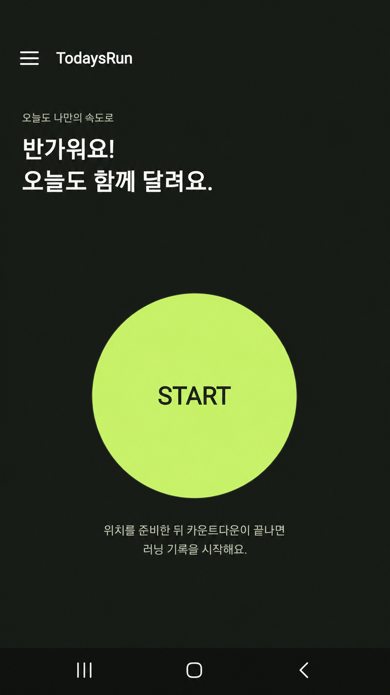
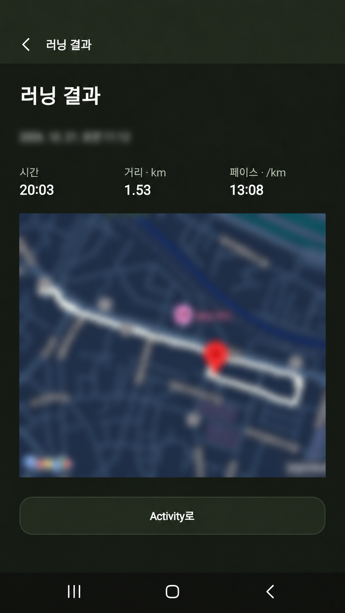
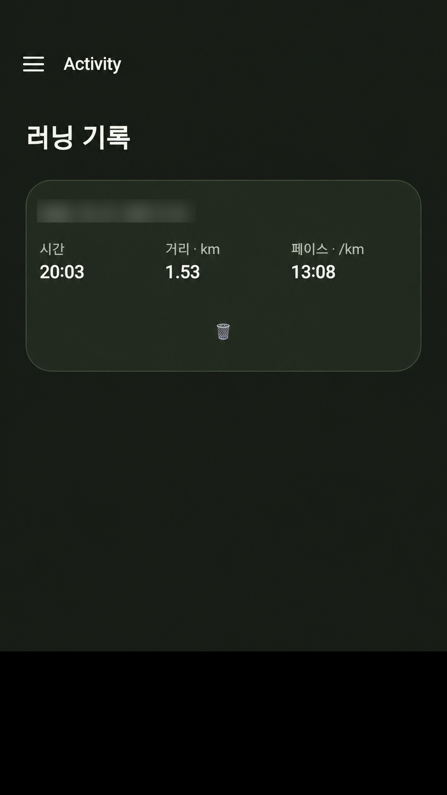

# TodaysRun

GPS로 **얼마나, 얼마나 오래, 어떤 경로로 달렸는지** 기록하는 Android 중심의 자유 러닝 앱입니다. 로그인 없이 시작하고, 운동 기록과 경로는 기기 내 SQLite에 저장합니다.

## 구현한 MVP

- 위치 권한·GPS 준비 후 3초 카운트다운으로 러닝 시작
- 지도와 드래그 가능한 Bottom Sheet에서 시간·거리·평균 페이스 확인
- 일시정지·재개·종료, Android 위치 서비스와 알림을 통한 백그라운드 기록
- 러닝 결과와 최신순 기록 조회, 개별 삭제·전체 기록 삭제
- 앱 재시작 시 미완료 기록을 마지막 저장 시점까지 종료·저장하거나 삭제

사용자가 종료한 0km·짧은 기록도 보존합니다. 훈련 계획, 소셜, 음성 안내, 웨어러블, 고급 통계, 로그인·클라우드 백업 및 동기화는 범위에서 제외했습니다.

## 실제 화면

| 홈 | 러닝 결과 | 러닝 기록 |
| :---: | :---: | :---: |
|  |  |  |

날짜와 지도 정보는 개인정보 보호를 위해 가려져 있습니다.

## 기술과 구조

| 구분             | 기술                                                         |
| ---------------- | ------------------------------------------------------------ |
| Framework        | React Native 0.86, Expo SDK 57, Expo Router                  |
| Language         | TypeScript                                                   |
| State            | Zustand                                                      |
| Database         | expo-sqlite                                                  |
| GPS / Background | expo-location, expo-task-manager, Android 로컬 Expo 모듈     |
| Map / UI         | react-native-maps, Bottom Sheet, Reanimated, Gesture Handler |

```text
src/app/                 화면 진입점과 Drawer·러닝·결과 라우팅
src/features/home/       위치 준비와 카운트다운, 러닝 시작 UI
src/features/run/        러닝 상태·GPS 도메인, 추적·저장·복구 서비스와 화면
src/features/activity/   완료 기록 목록·조회·삭제
src/features/settings/   위치 권한 확인과 백그라운드 기록·데이터 설정
src/database/            스키마, 트랜잭션, 러닝·좌표·설정 Repository
src/shared/ui/           공통 UI와 디자인 토큰
modules/run-environment/ Android 프로세스·단조 시계·추적 세션 연동
```

화면에서 SQL이나 GPS 계산을 직접 다루지 않도록 역할을 분리했습니다. Zustand는 진행 중인 러닝의 화면 상태를 관리하고, 완료 기록과 설정의 영구 데이터 기준은 SQLite로 두었습니다. 기능 기준은 [기획 문서](docs/PRODUCT_SPEC.md)에 정리했습니다.

## 설계하면서 고민한 점

### GPS가 끊겨도 이동 거리를 부풀리지 않기

GPS 좌표를 그대로 연결하면 위치 오차나 일시정지 중 이동까지 달린 거리로 계산될 수 있습니다. 정확도·측정 시각·비정상적인 속도를 검사한 유효 좌표만 반영하고, 일시정지 후 재개하거나 신호가 오래 끊겼다면 새 경로 구간을 시작하도록 했습니다. GPS 필터 기준은 실제 야외 환경에서 추가 검증이 필요합니다.

### 경로와 누적 거리가 서로 다른 상태로 저장되지 않게 하기

좌표와 누적 거리 중 일부만 저장되면 결과 화면의 경로와 기록이 어긋납니다. 두 작업을 하나의 SQLite 트랜잭션으로 묶고 DB 작업을 순서대로 처리하도록 했습니다. 중복 이벤트와 오래된 상태의 쓰기를 검사하며, 종료할 때는 최종 저장이 성공한 뒤 결과 화면으로 이동합니다.

### 화면 잠금과 앱 강제 종료를 구분하기

화면 잠금·앱 전환 중에는 Android 위치 서비스와 알림으로 기록을 시도하며, 추적 상태를 화면이나 메모리에만 의존하지 않도록 구성했습니다. 반면 앱이 강제 종료됐다면 중단 중 이동을 추정하지 않고, 마지막 저장 시점까지 종료·저장하거나 삭제하도록 했습니다. 강제 종료 이후 추적 지속은 보장하지 않습니다.

## 테스트

GPS 계산, 러닝 상태 관리, SQLite 저장·복구 등 주요 기능을 Jest 단위·통합 테스트로 검증했습니다.

- Jest: 303개 테스트 통과
- TypeScript / ESLint: 검사 통과
- Maestro: E2E 시나리오 검증 완료

Android 실기기에서도 실제 동작을 검증했습니다.

## 로컬 실행

Node.js 24·npm, Android SDK·JDK와 에뮬레이터 또는 USB 디버깅을 허용한 기기가 필요합니다. 루트에 `.env.local`을 만들고 Maps SDK for Android용 키를 설정합니다.

```dotenv
GOOGLE_MAPS_ANDROID_API_KEY=your_google_maps_android_api_key
```

```bash
npm ci
npm run android
```

개발 빌드 설치 후에는 `npm run start -- --dev-client`로 실행합니다. 실제 키와 서명 파일은 Git에 올리지 않으며, 키나 네이티브 설정을 변경하면 다시 빌드해야 합니다.

Android는 **앱 사용 중에만 허용** 위치 권한으로 시작할 수 있습니다. 에뮬레이터에서는 테스트 위치를 주입해야 하며, Expo Go는 화면 확인만 가능합니다. 현재 네이티브 모듈은 Android만 지원하며, iOS·Web은 검증 대상에 포함하지 않았습니다.

기록은 기기에 저장하므로 앱 데이터 삭제·앱 제거 시 사라질 수 있습니다.
